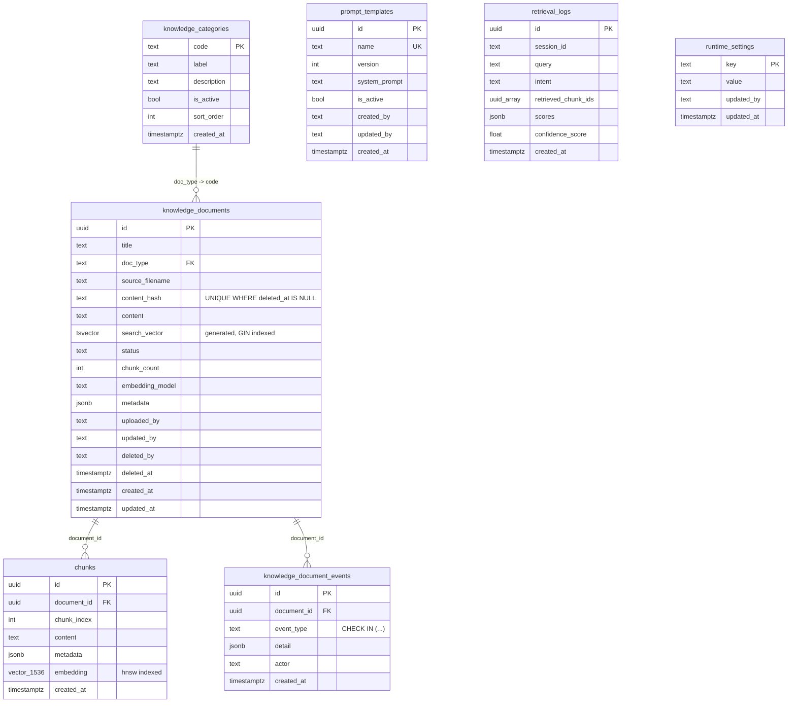

# Prisma in a Python service: schema/migration authoring only

This directory exists to author and version the SQL migrations for the
ai-service's own PostgreSQL + pgvector database (`career_compass_rag`) — the
knowledge base behind the AI Counsellor's RAG pipeline. **Prisma is never a
runtime dependency of this service.** Nothing here generates or imports
`@prisma/client`; the Python code (`rag/vectorstore.py`,
`rag/prompt_template_store.py`, `rag/runtime_settings.py`, ...) queries this
database exactly as it always has, via `asyncpg`. The production Docker
image stays pure Python — no Node.

This is a deliberate choice, not a placeholder: `apps/ai-service` has no
Node runtime, and `infra/k8s` has no existing Job/initContainer convention
to hang a `prisma migrate deploy` step off of. So migrations are applied at
boot by a small, dependency-light runner — [`db/migrate.py`](../db/migrate.py)
— instead of the `prisma` CLI. It reads the versioned `.sql` files under
[`migrations/`](migrations), applies any not-yet-applied ones in order
(each in its own transaction), and serializes concurrent replicas booting
at once with a Postgres advisory lock. `db/postgres.py::init_schema()` is
now a thin wrapper around it, called once per process from `get_pool()`.

## Why some migrations are hand-authored, not Prisma-generated

Prisma's schema language (`schema.prisma`) can't express everything this
database needs. Confirmed empirically while building this (not just from
docs) against Prisma 6.19.3:

- **No `WHERE` clause on `@@unique`/`@@index`** — `prisma validate` rejects
  it outright (tracked: [prisma/prisma#3627](https://github.com/prisma/prisma/issues/3627),
  still open). Needed for the partial unique index on
  `knowledge_documents.content_hash` (`WHERE deleted_at IS NULL` — a
  soft-deleted document's hash can be re-uploaded as a new one).
- **No `CHECK` constraint syntax** ([prisma/prisma#3388](https://github.com/prisma/prisma/issues/3388),
  still open). Needed for `knowledge_document_events.event_type`.
- **No `GENERATED ALWAYS AS (...) STORED` columns.** Needed for
  `knowledge_documents.search_vector` (full-text search).
- **No `USING hnsw` / `USING ivfflat` index syntax** for pgvector indexes.
  Needed for `chunks.embedding`'s vector index.

Two more that took a working session to actually verify (worth noting so
the next person doesn't have to rediscover them):

- **`extensions = [vector]`** on the datasource works, but drop `pgcrypto`
  from that list if you're tempted to add it — Postgres 13+ has
  `gen_random_uuid()` built in, `pgcrypto` isn't needed for it.
- **Prisma 7's `schema.prisma` no longer accepts a plain `url =
  env("DATABASE_URL")` datasource** for Migrate — it now wants a
  `prisma.config.ts` with a driver adapter. That's real added weight for a
  tool used here purely for schema authoring, so this directory pins
  **Prisma 6.19.3** (`package.json`) deliberately, not "whatever's latest."
  Don't bump the major version without checking this still holds.

**The practical rule this leads to:** every migration is either

1. **Prisma-authored** — plain tables/columns/FKs/btree indexes. Modeled in
   `schema.prisma`, generated via `npx prisma migrate diff --from-url
   <live-db> --to-schema-datamodel prisma/schema.prisma --script`, reviewed,
   then saved into a new `prisma/migrations/<timestamp>_<name>/migration.sql`.
2. **Hand-authored** — anything above. Written directly as a `.sql` file in
   the same `<timestamp>_<name>/migration.sql` layout (so lexical order
   still matches chronological order for `db/migrate.py`), and **not**
   modeled in `schema.prisma` at all.

That second point matters more than it sounds: modeling a hand-authored
object in `schema.prisma` just to "keep it documented" is actively
dangerous. `schema.prisma` is also the *desired end state* Prisma diffs
against — if it thinks it owns an object it can't fully express, a later
`migrate diff` will emit a `DROP`/replace for it. Confirmed this exact
failure mode while building this: after modeling `chunks.embedding`'s index
naively, a follow-up diff proposed dropping the real `ivfflat`/`hnsw` index
and replacing it with a plain btree one. The fix was to leave hand-authored
objects out of `schema.prisma` entirely and just describe them in a
comment. Verify this yourself before trusting any future diff: run
`npx prisma migrate diff --from-url <fully-migrated-db> --to-schema-datamodel
prisma/schema.prisma --script` and confirm the only things it proposes
dropping are exactly the hand-authored objects (and the `schema_migrations`
bookkeeping table, which is deliberately unmodeled too) — nothing else.

## Baseline migration

`20260821220000_baseline` recreates the schema that used to be created ad
hoc by `db/postgres.py`'s old `init_schema()` (`CREATE TABLE IF NOT
EXISTS` DDL run on every boot, no version history at all). Unlike every
migration after it, this one stays defensive (`IF NOT EXISTS` throughout)
because real dev/CI/prod databases already have this exact schema from
that old code path — it must be a safe no-op against them, not just
against a truly empty database. Verified against both cases during
development.

## Audit "actor" columns

`knowledge_documents.updated_by`/`deleted_by`, `prompt_templates.created_by`/
`updated_by`, `runtime_settings.updated_by`, and most
`knowledge_document_events.actor` values exist in the schema but will stay
`NULL` in practice: today, only `POST /knowledge/upload` receives an actor
identity from `apps/api` (`uploaded_by`, from `req.user.sub` — see
`admin-counsellor.controller.ts`). Delete, reindex, prompt-template CRUD,
and the LLM-provider setting accept no actor param from Nest at all yet.
The columns are forward-compatible and ready for a later, separate
`apps/api` change to thread an admin identity through the rest of those
calls — that follow-up is out of scope here.

## Adding a new migration

1. Apply everything that exists so far to a scratch/dev database (`db/migrate.py`'s
   `run_migrations()`, or just boot the service against it).
2. If the change is Prisma-expressible: edit `schema.prisma`, then run
   `npx prisma migrate diff --from-url <that-db> --to-schema-datamodel
   prisma/schema.prisma --script`. Review the output — discard anything
   touching a hand-authored object or `schema_migrations` (see above) —
   and save the rest as a new `prisma/migrations/<timestamp>_<name>/migration.sql`.
3. If not: write the `.sql` file by hand in the same layout, and leave
   `schema.prisma` alone (or add a documentation-only comment).
4. Apply it (`run_migrations()` again) and confirm it's idempotent — a
   second run must apply 0 migrations.
5. `tests/test_migrate.py` covers the from-empty, idempotency, and
   concurrent-boot cases generically — it doesn't need updating per
   migration, but run it.

## Schema (current)

